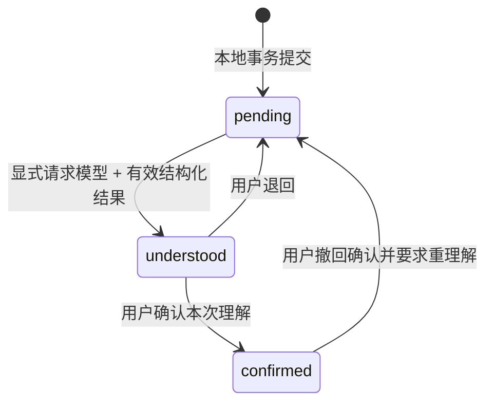

# 知不知 · Know-unknown 工程决策记录

日期：2026-10-19。状态：已采纳的 MVP 默认假设，可在产品验证后调整。

## ADR-001 目标、范围与默认假设

采用用户确认的「方案 B 动态认知状态底层逻辑 + 方案 A 极简交互」。打开即四象限；横轴左我不知道、右我知道；纵轴上 AI 知道、下 AI 不知道。只讨论已进入个人记录范围的信息，不展示模型的整个知识库。

目标：3 次操作内离线记录；严格区分落盘、模型理解建议与用户确认；随时导出、恢复和删除个人数据。象限四为快速记录入口；象限二的「＋」固定继承象限二归类，记录窗口不再二次选类型；知识、感受与经历统一输入，后者明确声明已知未知。象限一允许修订 AI 反馈但不新增，原文与模型原建议保留；象限二及象限四尚未收到反馈的原文可编辑，修改后待理解。象限三开放浏览入口，不生成虚假的未知条目；未来写回后也允许逐条删除。问题可跳过，回答使用同一个记录入口。

2026-10-19 首页交互调整（用户明确要求）：横纵轴连续实线，纵轴长于横轴，按手机竖屏布局；去掉顶部引导文案及底部口号。问题提示移入记录列表，首页只保留四象限与必要操作。

默认假设：

1. 第一版为手机优先 PWA，可添加到主屏幕；不承诺 App Store 原生包。使用简体中文。
2. **刚保存的个人记录留在象限四的待理解队列**；AI 产生可复核摘要后进入象限一（待确认），用户确认后才叫共同认知。这里对「保存后进入共同认知流程」作语义保守解释，避免坐标图错误宣称 AI 已知。
3. 用户主动声明的「我还不会」直接显示象限二，但没有模型时知识栏明确为空，不表示 AI 已知答案；象限二标题增加状态解释。不会推断用户不知道什么。
4. 无模型首版仅提供标明来源的、本地规则提示，不伪装成 AI 观察。已读不代表已理解，用户确认也不是客观真理。
5. 不预装示例私人记忆。一个浏览器来源是一份本地资料；主页面只有一个四象限，不区分知识与感受，旧 URL 的 category 参数自动移除，无路由库、账户、登录。

非目标：数字分身、自动监听/抓取、人格评分、向量库、RAG、多代理、聊天界面、团队协作、云同步、计费、内置大模型、自动生成未知的未知、证明模型真正理解人类。

## ADR-002 技术栈取舍

React + TypeScript + Vite；浏览器 IndexedDB；轻量自制仓储接口；vite-plugin-pwa 生成静态资源预缓存；Vitest + fake-indexeddb 进行领域/存储测试；Playwright 进行生产包浏览器测试。

| 选择 | 取舍 |
|---|---|
| PWA（采纳） | 单仓库、直接在 iOS/Android/桌面浏览器使用，离线记录足够；浏览器可能回收数据，后台任务能力受限 |
| Expo / React Native（延后） | 原生密钥安全存储、上架更适合后续，但首版会增加构建、设备适配与存储分支 |
| Flutter（未采纳） | 跨平台可行；当前无原生能力需求，引入 Dart 与原生构建不必要 |
| SQLite / 后端（延后） | 当前文本数据规模用 IndexedDB 足够。换存储只实现 Repository；不引入 ORM |

开发使用 Node 22.12+（本轮 Node 24）。具体依赖由 package-lock.json 固定。PWA 首次成功加载并缓存后才能离线重开；HTTPS 或 localhost 才能注册 Service Worker。参考 [Vite 官方](https://vite.dev/guide/)、[MDN Service Worker](https://developer.mozilla.org/en-US/docs/Web/API/Service_Worker_API/Using_Service_Workers)。

## ADR-003 状态机与四象限投影

记录分别持久化用户归类、录入入口和认知状态。展示象限仍按 kind 与状态投影，但同时显式保存并校验 quadrant，便于导出和 AI 阅读；不能仅靠原文推断归类，也不能用坐标或布尔 aiKnows 冒充认知证明。



- pending：已保存，AI 尚未给出理解。无模型、取消、超时、网络失败均保留该状态。
- understood：模型已返回理解建议，**不表示客观上真正理解**；UI 写「待确认」。只有有 provider、model、生成时间与非空摘要的结果才允许转入。
- confirmed：用户确认了该版本的摘要，UI 写「已确认」；撤回会删除旧建议，回 pending。
- 我知道（personal）：pending → 象限四；understood/confirmed → 象限一。
- 我不知道（known_unknown）：用户显式声明 → 象限二；无模型显示「知识待补充」。模型结果只是知识建议，不自动表示用户已学会；学会/迁移到象限一延后。
- 象限三用于待探索条目；当前记录格式与 NoAIAdapter 不生成这种条目。未来写回需定义有效格式和来源，不能宣称已经枚举双方未知。
- 处理期间是短暂 UI busy，不保存 processing；刷新后不出现卡死的 processing。
- 保存状态与认知状态正交：UI 只在 IndexedDB transaction complete 后显示保存成功。拒绝空输入，最多 4000 字。失败保留输入，可重试。

## ADR-004 数据结构与约束

详见 src/domain.ts 的可执行类型与校验。当前导出格式 schemaVersion=5，兼容读取 v1/v2/v3/v4；旧库中的知识、感受、待分类及缺失分类字段记录统一归一化，不再区分类别：

- Record：id、revision（每次变更的随机版本标记）、kind（personal/known_unknown）、text、status、createdAt、updatedAt、可选 analysis、quadrant（展示象限）、placement（declaredQuadrant、source、entryPoint）。
- Analysis：summary、provider、model、generatedAt、可选 question、独立 userRevision（summary/editedAt）；模型原建议是模型推断，原文始终不被覆盖。known_unknown 的 summary 是相关知识建议。
- Question：由记录中的 analysis.question 派生；无模型仅使用稳定 id 的本地通用提示；跳过 id 持久化，回答保存为新记录并跳过原问题。
- Archive：schemaVersion、cognitionContext（坐标、象限名称、归类意图与认知状态含义）、exportedAt、records、skippedQuestionIds。无 Key、设备标识或隐藏模型设置。

不采用事件溯源。导出/恢复与每次字段变更都进行运行时校验；除 v1/v2/v3/v4→v5 明确兼容路径外，未知版本拒绝。v2 归档先验证旧 category 有效，再移除这一字段；v3/v4/v5 不包含知识/感受分类。v4/v5 必须包含完整且一致的记录象限信息；旧格式仅从旧字段推定，不能伪造用户操作证据。导入是原子替换，UI 明确二次确认；失败不改变原档案；10MB 文件上限。重复 id、非法状态、无证据的 confirmed 都拒绝。模型内容只能以 React 纯文本展示，不渲染 HTML。

## ADR-005 存储层、隐私与可迁移性

Repository.read / add / update / skip / replace / clear 提供事务边界。IndexedDB 一个 records store + meta store；单条写入事务读取当前值、再变更，不用全量旧快照覆盖其他标签页。事务完成后再更新 UI；广播变更供其他标签页重读，页面恢复可见时也重读。

本地数据不出设备；没有分析 SDK、追踪、外部字体或默认联网请求。浏览器数据库未做应用级加密；同一设备/来源访问者可能读取。清除站点数据、隐私模式、空间回收会导致数据丢失，JSON 导出为明文。可在设置请求持久存储，但浏览器可以拒绝，不能承诺永久保留。用户可删除单条或清空全部个人数据。

手工导出/导入 JSON 是首版跨设备迁移方式。导出只包含归档内容。导入先解析验证，再提示替换本机数据；不信任外部文件中的任何文本指令。

## ADR-006 AI adapter 与信任边界

AIAdapter.analyze({schemaVersion, cognitionContext, record}, signal) → Analysis | null。NoAIAdapter 是运行时默认实现，返回 null、不发请求。AIService 仅接受有效结果；错误不改变 pending；输入包含选中的一条原文、象限与状态证据以及固定坐标说明，不默认发送所有记忆。

本轮实现 NoAIAdapter、服务编排边界和测试用 fake adapter。**不实现真实远程模型、不实现本地推理，界面也不收集 Key**。模型不可用时理解按钮禁用；不能用规则或回声摘要标记 understood。

后续远程 adapter：用户显式选择 provider/endpoint/model，在每次提交前能看到要发送的记录；Key 默认只在内存、永不进入归档/日志/Git。浏览器 API 受 CORS 影响；需要代理时由用户自行部署，不内置共享中转。原生包装阶段改用 Keychain/Keystore。禁止把 Key 写入 VITE_* 构建环境变量。网络设置单独校验 HTTPS/localhost，模型响应为不可信数据；无工具调用/任意代码执行。

后续本地 adapter：同一接口，对模型下载量、设备内存、响应时间和许可做真实验证；绝不宣称已内置轻量模型。远程分析需 timeout + AbortSignal，不自动批量发送、不在后台重试。模型生成问题必须关联记录，能跳过；不构造人格缺陷判断。

## ADR-007 离线、同步与并发

首版 local-only，**无云同步或后台 AI 队列**。离线与无模型不会阻止保存、读取、导出、跳过和删除。Service Worker 仅缓存同源静态 GET 资源，不缓存 API 请求/Key/私人文本；新版缓存就绪时提示用户主动更新；未确认时继续旧版，或等待旧窗口全部关闭。更新激活只刷新主动点击的窗口，其他窗口收到提示，避免编辑中强制刷新。

IndexedDB 事务串行化写入；记录 revision 是内容版本标记，AIService 提交理解时校验当前记录仍是发起时的 pending 版本，删除/撤回/重导入后迟到的结果不得回写。跨设备只支持用户确认的全量恢复，不声称合并或自动冲突解决。将来云同步需新增版本号、墓碑、冲突副本与端到端加密决策，不能把当前导入当同步协议。

## ADR-008 代码层次与验证

UI → Repository / AIService → 领域状态机；IndexedDB 和模型为边界适配器。无 Redux、后端、DI 容器。

```text
src/domain.ts              类型、状态迁移、导入校验、象限投影
src/storage.ts             IndexedDB 仓储 / 事务
src/ai.ts                  NoAIAdapter / AIService
src/App.tsx + styles.css    四象限、记录、浏览与反馈修订、数据设置
```

验收优先：无模型不会进入 understood；确认必须有摘要证据；保存失败不丢输入；刷新仍在；导出恢复不丢数据；并发新增不覆盖；离线冷重开；360px 宽无横向溢出；象限一反馈修订不能覆盖用户原文或模型原建议；跳过问题不再提示。自动化证据写入 docs/verification.md，真机手动验收另列。


## ADR-009 · 统一四象限（替代双导航设计）

用户最新决定：取消知识型与感受型的区分，降低输入负担。本条替代此前双导航的决策；历史验证记录仅记录当时的结果。

- 标题现为「知不知 / Know-unknown」（原型阶段为「你和AI的认知四象限」），没有分类导航、分类控件或待分类入口。
- 新记录没有 category 字段。所有已保存记录按 kind 与认知状态投影到同一个四象限，不以知识/感受过滤。
- 原有数据库名与对象仓库保持不变，读取所有旧记录并规范化；保留原文、id、revision、时间、状态、模型建议、来源和用户确认。读取不会清空或重建数据库。
- 合并分类阶段使用 schemaVersion=3；现由 v4 补充明确象限与来源。v1/v2/v3 归档在完整校验后统一恢复，v2 的旧分类元数据在规范化后不再使用，不丢弃任何记录。已有本地提示的跳过状态从旧 id 映射到统一 id；模型问题保留原标识和来源。
- 保存、AI 理解建议与用户确认仍严格区分。通用知识不是关于用户的事实，感受也不能被推断为客观能力；统一展示不自动认可任何模型推断。
- 当前仍只有 NoAIAdapter，默认只传选中的原文给未来 adapter；合并界面不等于实现了模型长期记忆或跨记录推理，也不授权自动上传整个数据库。

## ADR-010 · 轴线与标注的布局边界

用户截图暴露旧 `aspect-ratio + max-height` 外壳与 `height:100%` 子网格在受限高度/放大显示时可能不一致，卡片溢出，导致轴线过短、标注与底部状态被覆盖。

- 外壳使用明确的响应式 height。网格通过 absolute inset 在同一坐标区域内定位，不再依赖百分比高度与自动比例之间的循环计算。
- 网格上/下保留 52px、横纵轴两端留 24px，因此纵轴比卡片范围上下各延伸 28px。横轴横贯外壳，也延伸到左右卡片边缘之外。
- 中央横向间隔 44px、纵向间隔 36px，四端标注及状态区域不与任何卡片相交。
- 短屏保持最小可读高度，允许页面纵向滚动，避免硬压缩卡片；纵轴仍长于横轴。
- 浏览器验收检查实际几何关系：轴线越过卡片、卡片不与标注/状态相交、卡片子内容无溢出，并覆盖窄屏、短屏、150%/200% CSS 放大。


## ADR-011 · 正式名称与 GitHub Pages 路径

用户指定应用中文名「知不知」，英文名「Know-unknown」，仓库为 `ZHERLOCK0213/Know-unknown`。页面标题、浏览器标题、PWA Manifest、iPhone 主屏幕名称、导出文件名前缀与包名同步更新。旧 IndexedDB 名称保留，不更换本地资料库。

- Pages 构建通过 APP_BASE_PATH=/Know-unknown/ 设置 Vite base、Manifest id/start_url/scope、Service Worker scope 和离线导航回退；本地开发默认根路径。
- iPhone 图标使用同一前缀的 apple-touch-icon；应用资源不引用其他仓库路径。
- 发布工作流仅上传 dist，依赖锁定，CI 先跑测试与构建；部署权限仅 deploy job 获取。GitHub Actions 版本固定到官方示例中的完整 SHA。
- main 推送及手动 workflow_dispatch 触发部署。需要用户仓库权限和 Pages 的 GitHub Actions Source；私有仓库的 Pages 资格以账号实际设置为准，不能擅自公开源码。
- 不向先前未发布的 Sites 站点继续上传；旧工作目录在 work/ 中，Git 忽略。目标已切换为用户指定的 GitHub 仓库。
- 当前仅为静态离线记录工具，GitHub Pages 不提供 Codex 订阅推理或后端。AI 接入是后续独立任务。


## ADR-012 · 用户象限意图与 AI 阅读上下文

- 用户指定象限是独立事实。内容即使与象限定义不完全相符，也保留用户选择，AI 可以提出疑问但不能按语义静默改类。
- quadrant 表示当前展示位置；placement.declaredQuadrant 表示用户指定的基础象限；placement.entryPoint 表示创建记录时的入口。三者不能互相冒充。例如从象限二开始、手动选择「我知道」，入口仍是 upper_left，归类和当前展示为 lower_right。
- source=user 是用户新建或主动调整的归类；source=legacy_inferred 是根据旧 kind/status 推定。旧导出没有记录真实入口，迁移时保留 unknown。用户明确调整后可更新归类来源，但原入口仍未知。
- 新建、保存、导出、恢复与状态迁移均运行时校验：kind、展示象限、基础归类和认知证据必须一致。模型建议到达可让 personal 从象限四展示到象限一，保留 declaredQuadrant 和 entryPoint；撤回后回到基础展示位置。
- 象限二「＋」默认 known_unknown，象限四默认 personal；现按 ADR-016 固定入口类型，保存后可调整归类。待理解条目提供移动到象限二/象限四的操作，保留原文，生成新 revision，阻止迟到结果覆盖。
- 归档 schema v4 的 cognitionContext 包含四象限的中文名称、位置、双轴和状态含义。导入时使用应用的标准说明，不能将文件提供的任意说明当作系统指令。AIInput 与归档使用相同描述。
- 详细格式、兼容边界及未来 Markdown 投影见 archive-format.md。本轮没有云存储、Markdown 自动持久化、真实模型或对话结果写回；不将用户真实记录放入测试或公开仓库。


## ADR-013 · 主屏幕应用更新

- 版本 0.1.1 在「数据与隐私」显示应用版本与当前数据格式。版本号表示正在运行的程序，不以部署成功代替设备已更新。
- 继续使用 prompt 模式；处理 waiting 和 controllerchange，提供新版提示、手动检查及显式更新按钮。恢复可见/重新联网时最多每分钟检查一次同源静态应用资源，不上传记录，不产生模型请求。
- 检查完成后仍需等待安装终态，缓存失败/超时/离线分别反馈，不把 registration.update() 的请求完成冒充安装完成。
- 升级使用既有 Service Worker 的 SKIP_WAITING 协议。只在用户点击更新时刷新该窗口；运行 0.1.1 及以后代码的其他窗口，控制器变化仅提示，不自动刷新。早期已运行页面仍遵循其原有代码，首次升级前应保存并关闭。当前编辑器不显示更新按钮，保存、恢复事务与更新使用同一互斥边界。
- 更新不清空 Cache Storage、注销 Service Worker 或重建 IndexedDB。旧格式仍按已有兼容规则读取，不伪造历史象限入口。
- 早期无更新 UI 的运行页面无法凭空获得新按钮；先保存、导出并关闭所有旧页面，再联网重开，必要时再关闭重开一次。iPhone 的安装容器与系统生命周期仍需真机验收，桌面浏览器升级测试不冒充 iOS 验证。


## ADR-014 · 全部记录与标准象限编号

- 首页底部入口改为「全部记录」，计数与列表来自整份本机归档，覆盖全部象限与 pending / understood / confirmed 状态。它是全量浏览入口，象限四继续是快速新建入口。
- 调整象限、确认或撤回理解只改变条目的归类或状态，不能让它从全量列表消失。象限二和象限一仍是各自筛选视图；删除才移出全量列表。
- 卡片按象限一、象限二、象限三、象限四标注，采用本机中文无衬线字体与 700 字重。布局保留手机竖向坐标和轴线留白。
- 记录标注、编辑器目标、归档和 AIInput 使用同一套编号及名称。schema v4 的固定 cognitionContext.quadrants 增补 number / name；这是可重建描述元数据，旧 v4 缺失编号仍可读取，位置标识与记录格式不变，不升级或重建数据库。
- 仍无真实模型，列表中的状态与来源按原有证据校验。全部展示不把已保存冒充已理解。


## ADR-015 · 统一象限称呼与删除权

- 用户界面、产品说明和沟通只用「象限一 / 象限二 / 象限三 / 象限四」。标题、记录标注、移动按钮、空状态与 AI 描述一致。内部 upper_right / upper_left / lower_left / lower_right 标识为兼容旧归档保留，不展示给用户。
- 象限三不再是无法点击的永久空白区，现可打开只读列表，沿用公共记录组件和删除操作。象限一、象限二与全部记录中的条目，无论待理解、待确认或已确认，都允许用户逐条删除；确认/撤回与删除是不同动作。
- 每次删除需明确确认，取消不变；仅在 IndexedDB 事务完成后显示删除成功并广播更新。删除不触发模型请求，也不把模型建议改成用户事实。
- 本轮只开放象限三列表，未扩展记录格式：v4 仍只接受 personal / known_unknown 的既有投影，不接受实际属于象限三的内容。不得用绕过校验或伪造 understood 来填充象限三。
- 下一步写回协议必须支持象限一与象限三有内容、可查看与删除。象限三条目应明确为探索线索而非已知事实，需单独定义格式版本、来源和状态；写回前预览并取得用户确认。删除后的迟到结果不能恢复记录，导入备份恢复仍遵循现有替换确认。这些属于后续实现，本轮无写回接口。


## ADR-016 · 批注驱动的极简交互与反馈修订（2026-10-20）

- 卡片移除中央大图标及重复箭头，象限二/三用直白标题，象限四呈现「我知道，AI 不知道」与当下状况例子；保持粗体象限编号。
- AI 轴标签使用竖排文字；纵轴上下预留 64px，网格上下预留 88px、最大宽度 500px，替代 ADR-010 的旧尺寸。仍检查实线超出卡片、纵轴长于横轴、标注与内容不重叠。
- 象限二新增按钮 44px 点击区；记录窗口继承入口、不再选类型，标题为「记录」，关闭按钮至少 44×44px。未保存更改的关闭保护继续有效。
- 用户明确：象限一的笔形入口指修订 AI 反馈，不修改用户原文，也不能新增反馈。已有原文、模型建议与用户修订三者分别保存；userRevision 有独立时间，模型返回值不能伪造此来源。
- 修订已有反馈生成新 revision，status 回 understood / 待确认，保留象限。用户再确认；修订尚未发送给模型，不宣称 AI 已学到它。重新理解移除分析/修订前提示确认。
- 尚无模型反馈的用户原文可编辑，生成新 revision；空白/超长拒绝，失败保留输入；并发变化与迟到结果按原仓储边界拒绝覆盖。
- 用户明确语音使用 iPhone 系统键盘听写。本应用不增加麦克风按钮、录音、联网识别或语音依赖；不能把桌面输入测试冒充 iPhone 听写真机验证。
- 新用户文本必须可导出：schema v5 增加 analysis.userRevision，兼容 v4 的完整象限元数据与 v1/2/3 推定路径。IndexedDB 名称和版本不变，读取旧记录不重建库；v5 导出供支持新格式的版本恢复。


## ADR-017 · 编辑后的列表上下文（2026-10-22）

- 从记录列表编辑反馈或原文时，保留来源列表、滚动位置、触发按钮与已展开的原建议。编辑中隐藏列表，保持列表组件挂载，不额外叠加弹窗。
- 无修改关闭、确认放弃修改、Esc 取消和保存成功后均回到原列表位置，焦点回到该条目的编辑按钮；关闭列表才返回首页。拒绝放弃草稿或保存失败时继续留在编辑器。
- 首页新建记录仍在保存或取消后返回首页，不继承先前编辑的返回位置。此改动不修改记录状态机、数据库、归档格式或 AI 请求边界。


## ADR-018 · 固定弹窗顶部与独立滚动内容（2026-10-22）

- 弹窗顶部常驻标题、说明与关闭按钮，记录内容在下方独立滚动；用同一弹窗的两个布局区域实现，避免内容覆盖顶部操作。
- 编辑器与数据设置沿用固定顶部；列表进入编辑前缓存内容区的滚动位置，取消或保存后恢复该位置与按钮焦点，保留已展开的原建议。
- 使用动态视口高度限制弹窗，内容区可收缩；关闭按钮保留至少 44×44px 点击区。短屏仍能滚动记录并直接关闭，无需先回到列表顶部。
- 不改变记录、理解建议、用户确认或归档格式；不重建数据库。
